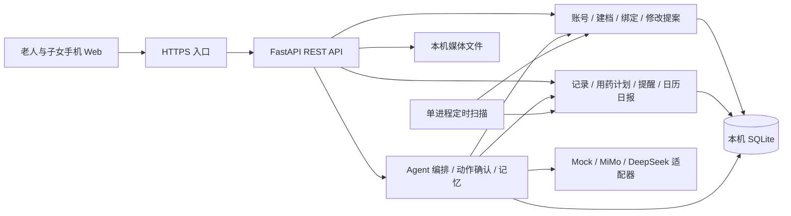

# VitaSenior 后端开发计划

版本：v0.2，2026-10-30。状态：总体开发计划；F0公共框架已验收，业务闭环尚未实现，实际结果见[框架交接记录](协作/框架交接记录.md)。

配套文档：[接口说明](后端接口说明.md)、[三人分工与联调安排](三人分工与联调安排.md)、[产品计划](../银龄老年健康助手计划.md)。业务字段与 HTTP 契约以接口说明为准；三人指三位开发者。

执行顺序以新增的[框架开发计划](框架开发计划.md)为准：F0 单人建立公共框架 → F1 验收并按实际代码发布三份任务单 → F2 并行补业务。[Agent 开工提示词](Agent开工提示词.md)中当前仅框架提示词可直接使用。下文 A/B/C 是候选模块归属，公共模型/schema 的实现和冻结先由 F0 统一完成。

## 1. 已确定的目标

- 仓库从零开始，暂不接已有前端；先用 API 文档、请求样例和自动化验收脚本联调。
- Python + FastAPI + SQLite，电脑运行服务，手机 Web 访问。优先低成本 HTTPS 转发与扫码体验。
- 产品为通用日常健康管理与长期跟踪；饮食种类/搭配、用药提醒、运动记录、家庭协同、Agent 记忆构成核心。糖尿病是演示人物背景。
- 模型、ASR、TTS 在调试阶段使用可控 mock。账号与社区样本也使用演示数据；业务记录、绑定、待办和状态变化实际落库。
- 家人实时视频/语音通话已移除；保留与小安的摄像头/语音交互、录音关怀和应用内模拟来电。
- 页面打开时进行应用内提醒；关闭期间按载体能力尝试系统通知，实现困难则放弃该渠道，保留待办。系统推送成功不代表应用内已送达。
- 子女代维护的修改：老人进入应用、接听并完成播报后，才开始 60 秒可否决窗口；未明确拒绝则生效。未进入、未接听、未播报完成均不启动窗口。
- 日历反映饮食、运动、用药记录完成度，不计算疾病风险分。

## 2. 为了开工采用的默认决策

以下是可调整的工程默认值，不需要阻塞开发：

| 项目 | 默认方案 |
| --- | --- |
| 时间 | 服务端存 UTC；日历、餐次和提醒按 Asia/Hong_Kong 划日 |
| 亲属关系 | 数据支持一位老人绑定多个子女、一位子女绑定多位老人；看板每次查询一位老人 |
| 登录 | 演示验证码 `123456`，不发短信；生成的不透明 Bearer token，有效 48 小时 |
| 绑定码 | 四位数字、5 分钟有效、单次使用；所有有效码全局唯一；重新生成使旧码失效 |
| 双端同步 | 前台通知每 3 秒轮询；看板每 5 秒或操作后刷新；不依赖 SSE/WebSocket |
| 在线状态 | 可见页面每 10 秒心跳；25 秒未更新视为不活跃；查询通知列表不等于送达 |
| 后台任务 | 单进程内每 5 秒扫描数据库到期任务；时间与任务状态落库，重启可恢复 |
| 观众体验 | 每次创建独立演示家庭及账号，不共用一位老人的可写记录；输入有效绑定码才授权共享 |
| 历史数据 | 每个演示家庭预置过去 14 天的示例记录并标注来源；不生成这些历史记录的过期用药提醒 |
| 待关注项 | 缺记录、待确认、子女关怀等可解释状态；没有规则来源的风险评级/药物冲突仅保留明确标注的示例素材或返回未启用 |

## 3. 交付范围与取舍

### P0：先形成可验收闭环

1. 服务骨架、数据库、统一错误、鉴权、媒体上传、可重放的初始化数据。
2. 老人/子女登录，身份信息与模拟人脸匹配，社区档案预填及确认。
3. 老人通过 API 或小安生成绑定码，子女预览并绑定。
4. 饮食按餐次记录、运动多次记录、按计划服药记录；支持纠正和取消。
5. 固定时间、餐后延迟两类用药提醒，日常打卡提醒与上线待办。
6. 子女录音/预设关怀提醒、横幅/模拟来电事件回传。
7. 子女代维护修改的待通知、可否决、自动生效与冲突处理。
8. 日历、日报、看板使用同一套真实记录计算结果。
9. mock Agent 意图、确认动作、查询、绑定码、记忆读写；能跨会话体现习惯记忆。
10. 使用请求脚本完成演示闭环，服务重启后数据仍存在。

### P1：P0 稳定后补齐

- 接入 MiMo，或 DeepSeek + 音频供应商；先验证文字/图片，再接 ASR/TTS。
- 已有会话历史查询、Markdown 记忆导出、解除绑定、计划停用、提案撤销。
- 限时尝试 Web Push：最多投入 1 小时完成受控设备验证；不通则 `unsupported/failed`，回到应用内待办。
- 展示预置血压/血糖曲线等原始样例数据，不增加专病管理工作流。

### P2：可直接用素材展示

商城、配送、积分兑换、复杂激励、复杂数字人动画、自动医学风险评级、真实药物冲突知识库。后端仅按需返回静态素材，不建设交易、配送或诊疗系统。

## 4. 架构与目录



建议 Python 3.11 或 3.12；项目启动时锁定团队共同验证过的依赖版本。使用 FastAPI、Uvicorn、Pydantic、SQLAlchemy、httpx、python-multipart；pytest 与 httpx 用于验收。无需 Redis、Celery、向量数据库或工作流平台。

SQLite 文件放电脑本地磁盘，启用外键、WAL、合理的 busy timeout。写事务尽量短；模型调用和音频转换在事务之外完成。服务只开一个 worker，避免重复扫描任务。[SQLite WAL 说明](https://www.sqlite.org/wal.html)

```text
backend/
  app/
    main.py                     # F0统一建立，F2由集成人维护
    core/                       # F0统一配置、DB、鉴权、时钟、错误、幂等
    models/
      identity.py               # A：账号、老人、亲属、绑定码、修改提案
      health.py                 # B：打卡、用药计划、通知
      agent.py                  # C：对话、待执行动作、记忆文档
    schemas/                    # F0统一定义，F2共享冻结
      common.py
      identity.py
      health.py
      agent.py
    routers/                    # 各负责人只改自己的路由文件
    services/                   # 业务规则集中在这里，Agent 同样调用这些服务
    contracts/                  # F0统一typed ports与共享上下文
    application/                # 按领域分文件协调ports与事务
    composition.py              # 唯一的具体实现组装入口
    providers/                  # C：ASR、理解模型、TTS 的 mock/真实实现
    scheduler.py                # B：扫描提醒与自动生效提案
    seed.py                     # A 入口；B/C 各供自己的 fixture
  fixtures/                     # 样本库、历史记录、mock 场景与音频
  tests/                        # 以业务不变量与闭环验收为主
  pyproject.toml
  .env.example
data/                           # SQLite、上传文件、导出记忆；不提交实际运行数据
```

FastAPI 的 lifespan 管理扫描任务启动/停止；每次启动重新读取未完成任务，而不是用仅存在内存里的 60 秒定时器。[Lifespan 文档](https://fastapi.tiangolo.com/advanced/events/)

以上是总体目录概览，完整F0文件清单见框架开发计划。业务模块通过typed port调用其他领域，不直接导入对方service实现；表格中的负责人表示业务维护归属，不表示可独自修改冻结数据结构。

## 5. 数据模型与唯一约束

| 表/数据 | 负责人 | 关键字段及约束 |
| --- | --- | --- |
| users / auth_sessions | A | 用户角色、演示手机号、demo_id；会话 token 摘要及过期时间；演示手机号全局唯一 |
| elder_profiles | A | owner_user_id、profile_json、reminder_settings_json、onboarding_draft、version；一位老人有明确所有者 |
| community_samples | A | 只读 JSON fixture；按演示身份键查找，模拟人脸不用于真实身份判定 |
| family_bindings | A | elder_id、child_user_id、relationship；有效关系唯一 |
| binding_codes | A | code、elder_id、expires_at、consumed_at；有效码唯一；消费事务内检查过期及单次使用 |
| media_assets | A | 所有者、elder_id（可空）、MIME、大小、本地相对路径；对外只提供受控内容地址 |
| medication_plans | B | 名称、展示用量、fixed/after_meal 时间表、active、version；不由模型自动决定剂量 |
| daily_tasks | B | elder_id、local_date、category、slot_key、计划快照、due_at；每日目标唯一，历史目标不随新计划变化 |
| checkins | B | elder_id、type、local_date、occurred_at、task_id、payload_json、slot_key、version、revisions_json、cancelled_at |
| notifications | B | source_key 唯一、kind、due_at、delivery_state、task_state、push_state、关联提案/计划 |
| change_proposals | A | target_type/id、base_version、patch、before_snapshot、status、notification_id、auto_apply_at |
| agent_turns / agent_actions | C | conversation_id、client_turn_id、结构化回复；动作 pending/confirmed/cancelled/expired、结果引用 |
| memory_documents | C | elder_id 唯一、version、entries_json、updated_at；一位老人一份逻辑文档 |
| idempotency_records | A | actor+method+path+key 唯一、请求摘要、结果、过期时间；避免重试产生重复写入 |

日历、日报、看板从每日目标快照与记录计算，不再复制保存一份分数。daily_tasks 只保存当时适用的目标与计划快照，完成状态由有效打卡计算。记忆的条目和版本作为 SQLite 内唯一事实来源，按需渲染为 Markdown；本地 `memory.md` 是可重建导出，不承担跨文件事务。

## 6. 关键业务规则

### 6.1 打卡、计划与完成度

- 饮食：同日同餐次一条有效记录；再次提交显式替换并保留修订信息，不能叠加成两餐。
- 运动：每次活动独立记录；当天有一条有效运动记录即满足日历的运动项。
- 用药：必须关联计划及具体服药时段。记录中的 `taken/not_taken` 与提醒的 `snoozed` 分开；只有明确确认 `taken` 才计入已服用次数，听完提醒不等于服药打卡。
- 饮食默认三餐，运动默认每日一项，用药按当日适用计划计算。未配置用药计划时，该项不进入分母；当天未到时间的项目显示待进行，不标为漏服。
- 绿色表示适用项目全部完成；黄色表示部分完成或当天已有进度；灰色表示没有有效记录；未来留空。详细进度展示各项计数。
- “未打卡”仅表示无记录。取消/纠正后，所有读取端使用最新有效版本。

### 6.2 提醒与通知

- 提醒是一条持久化待办；推送仅为可选送达渠道。推送失败、无权限、不支持、页面关闭均不丢失待办。
- 正常页面的可见心跳 + `displayed` 回执才记录应用内送达。读取列表、系统推送返回成功、页面隐藏，均不算应用内送达。
- 播放类通知依次上报 `answered`、`playback_completed`。普通提醒的处理状态与播放状态分开。
- 餐后提醒以确认的该餐实际时间加延迟计算；未记录进餐时不凭空生成“已餐后”事件。补录历史餐次只产生待核对事项，不触发历史通知轰炸。
- 修改用餐记录时，尚未送达的关联提醒更新到期时间；已送达的保留历史，不重复来电。
- 跨日待办可显示“之前记录待确认”，不把积压的服药时段改成现在应服用的指令。
- Web Push 为 P1，依赖浏览器订阅与 Service Worker；拒绝授权或适配不通直接回落到待办。[Push API](https://developer.mozilla.org/en-US/docs/Web/API/Push_API)

### 6.3 子女代维护修改

1. 子女提交修改提案，目标档案/计划暂不变化，同时创建关联通知。
2. 老人未进入或未完成播报：`pending_notice`，`auto_apply_at = null`。
3. 老人完成播报：`awaiting_decision`，服务端记 `auto_apply_at = played_at + 60s`。
4. 老人明确接受立即应用；窗口内拒绝则终止；到期扫描自动应用。
5. 应用时校验 `base_version`；目标已变化则标 `conflicted`，供子女重新提交，避免覆盖较新内容。
6. 一旦通知完整完成，倒计时由服务端继续；之后关闭页面不撤销已经送达的通知。重播和重复回执不重置倒计时。
7. 拒绝和到期竞争时使用数据库事务决定一次最终状态；已生效后的纠正走新修改，保留前后内容。

此规则只适用于代维护修改，不能扩展成自动确认老人已服药、已运动。

### 6.4 Agent、工具与记忆

- ASR、理解模型、TTS 三个适配器分别配置 `mock/mimo/deepseek/其他`；客户端不持供应商密钥。
- mock 提供可选场景及明确的模拟标记；未知语句返回引导，不把任意图片都当成某个固定菜品。
- 理解模型输出回复、结构化事实、动作建议、记忆候选。写操作走业务服务和权限校验；拍照分析结果不会直接当作已确认打卡。
- 打卡和本人档案修改先生成待确认动作；老人点确认或在下一轮明确口述确认后，使用同一 action_id 执行一次。查询和明确要求生成绑定码可直接执行。
- 一次模糊的“吃了药”若匹配多个计划，先追问；不自行选药或补齐剂量。
- 明确偏好可直接形成记忆；习惯归纳默认至少有三个不同日期的有效记录支持。每条记忆带来源和更新时间，纠正原记录后使相关归纳失效并重新整理。
- 健康档案、用药计划、当天记录是回答事实；记忆不能覆盖这些事实，也不能新增确诊疾病。
- 为每位老人提供 Markdown 上下文，保存偏好、生活规律、沟通偏好与近期待关注事项；不保存无关聊天全文到长期记忆。

## 7. 38 小时内的交付顺序

用 `T` 表示真实路演开始时刻。最初的 38 小时已经包含讨论耗时，下面不是重新获得 38 小时；若某个节点已过去，立即执行其交付目标，优先削减 P1/P2。

| 截止节点 | 必须看到的交付 | 联调方式 |
| --- | --- | --- |
| 尽快，约 T−34h | 三人统一字段；骨架、DB、演示账号、`/docs` 可用；B/C 能独立调用基础服务 | 第一组登录/鉴权请求 |
| T−26h | 第一个完整闭环：登录→建档→绑定→mock Agent→确认饮食记录→子女看板 | 两个 token、同一 elder_id 跑请求脚本 |
| T−16h | 用药计划、提醒事件、日历、代维护窗口、跨会话记忆都可运行 | 离线/重启/重复请求专项验收 |
| T−10h | P0 验收通过；若账号就绪，完成至少一轮真实模型/音频探测 | 固定图片、固定录音与实际手机各一轮 |
| T−6h | 功能冻结；接口与 OpenAPI 导出固定；只修阻断问题 | 接口说明与实际响应逐项核对 |
| T−2h | 电脑重启后恢复；HTTPS 手机实测；团队演示账号、观众独立数据均验证 | 两台手机完整走两遍，记录耗时 |
| T−0 | 保留已验证的工作版本、数据备份和 mock 开关 | 停止新功能与依赖升级 |

## 8. 验收清单

| 编号 | 验收条件 |
| --- | --- |
| AC01 | 登录后未绑定子女无法读取任意 elder_id；绑定后可读授权老人的数据 |
| AC02 | 有效绑定码只能消费一次，过期码和重新生成前的旧码不可用 |
| AC03 | 社区样本匹配只生成草稿，确认后才作为正式档案使用；无匹配可手动建档 |
| AC04 | 同餐替换、运动累加、用药时段唯一，重复请求不重复打卡 |
| AC05 | 未打卡不返回“已确认没服药”；接听提醒不自动变成已服用 |
| AC06 | 关闭页面期间创建的通知仍在，上线后可获取；推送结果不会启动修改倒计时 |
| AC07 | 未接听或未播报完成的修改提案，任意推进时间均不自动生效 |
| AC08 | 完成播报后 60 秒自动应用；窗口内拒绝不应用；重复回执不延长窗口 |
| AC09 | 通知、倒计时和待办可跨服务重启恢复；版本冲突不覆盖目标内容 |
| AC10 | 老人/子女日历、日报、看板对同一记录得到一致结果，纠正后同步变化 |
| AC11 | 明确偏好能跨会话读取；单次异常事件不被保存为长期习惯，来源被取消后重新整理 |
| AC12 | 多观众创建不同演示家庭，打卡和记忆互不覆盖；只有明确绑定才共享 |
| AC13 | ASR/模型失败不产生业务写入；TTS 失败时可返回文字与明确降级状态 |
| AC14 | mock 和真实适配器使用同一业务契约；运行状态明确返回实际 provider，不静默冒充真实模型 |

时间相关用例采用可注入时钟推进，不在测试里真实等待 5 分钟或 60 秒。优先为上述有状态规则写测试；静态素材无需测试堆砌。

## 9. 启动、配置与交付物

开发时建议在 `backend` 下启动 `uvicorn app.main:app --host 0.0.0.0 --port 8000 --workers 1`；演示使用单进程且不带自动重载。该命令已在F0可运行；当前业务接口能力仍以runtime及交接记录为准。

配置至少包含：`APP_ENV`、`DATABASE_URL`、`DATA_DIR`、`PUBLIC_BASE_URL`、`CORS_ORIGINS`、`APP_TIMEZONE`、`CHAT_PROVIDER`、`ASR_PROVIDER`、`TTS_PROVIDER`、各 provider 的 base URL/model/key、`WEB_PUSH_ENABLED`。全 mock 默认不要求供应商密钥。

交付：可复现依赖、`.env.example`、样本/历史数据初始化命令、分组验收请求脚本、测试结果、运行 OpenAPI 导出、部署说明。`/docs` 和 `/openapi.json` 在实现后用于核对契约。[FastAPI 文档配置](https://fastapi.tiangolo.com/tutorial/metadata/)

电脑与手机首轮即验证 HTTPS、录音和摄像头权限。临时转发若使用 Cloudflare Quick Tunnel，按其官方限制避免 SSE，使用短轮询；随机域名变化后更新 `PUBLIC_BASE_URL`、二维码和允许来源。[Quick Tunnel 限制](https://developers.cloudflare.com/tunnel/get-started/quick-tunnels/)

当前没有必须再由用户决定的产品问题才能开工。开发者姓名、真实路演时刻、实际模型账号和转发渠道可在开工会补入，不改变此处的模块边界。
