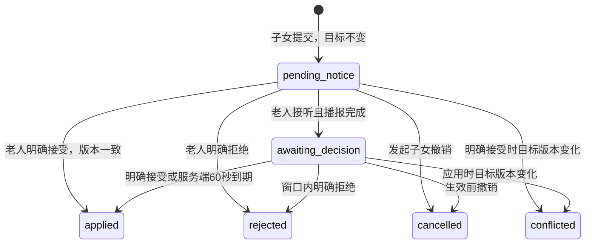

# VitaSenior 后端接口说明汇总

版本：v0.3，2026-10-31。**当前状态：45 个 P0 全部已实现并通过验收**（`/runtime` 的 capabilities
全为 true，仅 P1 的 `web_push` 为 false）；F1 实现后的实际契约见 §7.1。P1 接口
（AUTH03/BIND05/PLAN04/CHANGE05/MEM04/PUSH01–03）尚未挂载。配套：[开发计划](后端开发计划.md)、
[候选分工](三人分工与联调安排.md)、[框架开发计划](框架开发计划.md)。

先由F0统一补齐并实现Pydantic schema、路由和内部port，再导出实际OpenAPI作为并行基线；F1后才发布业务任务。未完成模块使用501占位，不返回假的业务成功。业务语义与本文保持一致，新增类型细节需同步记录。

当前F0已复验，见[F1验收与开工说明](协作/F1验收与开工说明.md)。A0补齐内部入口和播放授权后更新准确签名/快照；B/C依赖新增入口前先合入共享适配。第7节是原F0实际定义，不能把未实现的port视为可用业务。

## 1. 通用约定

- 基础路径 `/api/v1`；下文路径均省略该前缀。框架的 `/docs`、`/openapi.json` 在根路径。
- JSON 使用 snake_case；所有 ID 是不透明字符串，客户端不可解析其中含义。示例 ID 需要替换为前序响应中的实际值。
- 除演示入口、登录、健康检查和带短期票据的媒体内容外，使用 `Authorization: Bearer <token>`。
- `elder` 是老人账号，`child` 是子女账号。老人只能操作本人档案；子女必须有有效绑定才能访问目标老人。
- 子女直接写档案、用药计划、提醒设置返回 `403 PROPOSAL_REQUIRED`，必须走修改提案。健康打卡 P0 由老人确认，子女只读；代打卡可后续扩展。
- 请求时间用 UTC ISO 8601，如 `2026-10-30T04:10:00Z`；业务日期用 `YYYY-MM-DD`，按 Asia/Hong_Kong 换算。提醒的 `08:30` 是该时区本地时刻。
- 有版本的资源修改需 `expected_version`；版本不匹配返回 409。PUT 中的 `patch` 是局部字段替换，数组整体替换；不使用隐含的 JSON Patch 语义。
- 创建/修改、绑定消费、Agent 轮次与确认、事件回执携带 `Idempotency-Key`。心跳、纯预览、ASR/TTS 不强制该头。相同用户、方法、路径、key 的重复请求返回原结果；同 key 不同请求体返回 409。保存至少 48 小时。读权限仍须检查；公开创建体验的请求用不可预测的客户端 key 去重。
- 列表用 `limit`（默认 20，最大 100）、`cursor`；响应 `items`、`next_cursor`。日历、每日任务等明确限定范围的小集合不用分页。
- 创建一般返回 201，普通读取/修改和幂等重放返回原 HTTP 状态；删除采用软删除并返回 200；无需异步作业系统。

成功响应：

```json
{
  "data": {"id": "record_demo_001"},
  "meta": {
    "request_id": "req_demo_001",
    "server_time": "2026-10-30T04:10:00Z"
  }
}
```

错误响应（包括框架验证错误，不能另返回一套格式）：

```json
{
  "error": {
    "code": "VERSION_CONFLICT",
    "message": "内容已更新，请刷新后再提交",
    "details": {"current_version": 3},
    "retryable": false
  },
  "meta": {
    "request_id": "req_demo_002",
    "server_time": "2026-10-30T04:10:00Z"
  }
}
```

以下对象定义和业务样例表示 `data` 内部，除非注明为完整响应。字段标 `?` 表示可省略；`null` 表示明确无值。业务必填与互斥条件必须反映到 Pydantic/OpenAPI。

## 2. 全部接口索引

`P0` 为本轮闭环；`P1` 为闭环后补齐；`P2` 为可选素材。负责人 A/B/C 对应分工文档。一个写接口必须只有一个最终事务协调入口。

### 2.1 服务、演示与账号（A）

| 编号 | 优先级 | 方法与路径 | 访问者 | 输入 → data |
| --- | --- | --- | --- | --- |
| SYS01 | P0 | GET /health | 公开 | 无 → `{status, database, scheduler}`，状态 `ok/degraded` |
| SYS02 | P0 | GET /runtime | 已登录 | 无 → `{mode, providers, capabilities, timezone, server_time}`，不返回密钥 |
| DEMO01 | P0 | POST /demo/experiences | 公开，限流 | `{scenario?: "diabetes_daily"}` → `DemoExperience` |
| AUTH01 | P0 | POST /auth/code | 公开，限流 | `{phone, role}` → `{challenge_id, expires_in:300, demo_code:"123456", is_mock:true}` |
| AUTH02 | P0 | POST /auth/login | 公开 | `{phone, role, challenge_id, code}` → `{access_token, expires_at, user, elder_id, bound_elders}` |
| AUTH03 | P1 | POST /auth/logout | 已登录 | 无 → `{logged_out:true}` |
| AUTH04 | P0 | GET /me | 已登录 | 无 → `{user, elder_id, bound_elders}` |

`role` 取 `elder/child`。AUTH01 仅向演示入口分配的手机号或团队预置账号签发 challenge；不向真实手机号发送短信。AUTH02 校验 challenge 归属、用途及到期后签发会话。验证码是 mock，资源权限仍实际执行。

`DemoExperience`：`{demo_id, scenario, is_mock:true, elder_account:{phone,role}, child_account:{phone,role}, elder_id, entry_url, pair_entry_url, history_days:14}`。每次 DEMO01 创建新的账号及老人草稿，默认没有亲属绑定；history_days 表示可导入的历史模板天数，历史数据在确认建档后导入。两台设备可共享 pair_entry_url 的演示上下文，仍须独立登录、输入绑定码。手机号由服务分配并保持全局唯一；演示上下文不能代替资源授权。重放同一幂等 key 不再创建一组数据。

### 2.2 社区建档、档案与绑定（A）

| 编号 | 优先级 | 方法与路径 | 访问者 | 输入 → data |
| --- | --- | --- | --- | --- |
| ONB01 | P0 | POST /elders/{elder_id}/onboarding/match | 本人 | `{sample_identity_key, face_asset_id?}` → `{match_status, draft_id, profile_draft, medication_plan_drafts, is_mock:true}` |
| ONB02 | P0 | POST /elders/{elder_id}/onboarding/confirm | 本人 | `{draft_id, profile, medication_plans, expected_version}` → `Profile` |
| PROF01 | P0 | GET /elders/{elder_id}/profile | 本人/已绑定子女 | 无 → `Profile` |
| PROF02 | P0 | PUT /elders/{elder_id}/profile | 本人 | `{expected_version, patch}` → `Profile` |
| BIND01 | P0 | POST /elders/{elder_id}/binding-codes | 本人 | 无 → `{code, expires_at, display_text}` |
| BIND02 | P0 | POST /family-bindings/preview | 子女 | `{code}` → `{elder_display_name, masked_identity, already_bound, expires_at}` |
| BIND03 | P0 | POST /family-bindings | 子女 | `{code, relationship}` → `{binding_id, elder_id, relationship, status:"active"}` |
| BIND04 | P0 | GET /me/elders | 子女 | 无 → `{items:[ElderSummary]}` |
| BIND05 | P1 | DELETE /family-bindings/{binding_id} | 关系中的任一方 | 无 → `{binding_id, status:"revoked"}` |

ONB01 的 `match_status` 为 `matched/not_found`，均产生可确认的草稿；正式 Profile 暂不改变。`face_asset_id` 为相机演示素材，不用于真实生物识别。medication_plan_drafts 与 medication_plans 均是 MedicationPlanWrite 数组，无计划传空数组；草稿计划随 ONB02 一起由 A 调用 B 的导入服务落库，不把药品只藏在档案 JSON 里。

演示样本匹配并确认时，一次性导入相应计划、过去 14 天的任务/记录与记忆素材；以 demo_id/source_key 去重。无匹配的手工建档不凭空生成历史。重复确认或登录不重复导入，历史任务不产生新来电。

Profile：

```json
{
  "elder_id": "elder_demo_001",
  "version": 1,
  "onboarding_status": "confirmed",
  "display_name": "陈阿姨",
  "birth_date": "1958-05-12",
  "sex": "female",
  "conditions": ["糖尿病（演示档案）"],
  "allergies": [],
  "medical_notes": "社区体检样本档案",
  "timezone": "Asia/Hong_Kong",
  "source": "community_mock",
  "updated_at": "2026-10-30T02:00:00Z"
}
```

允许 patch：`display_name/birth_date/sex/conditions/allergies/medical_notes`。用药与提醒时间走独立资源。`source` 为 `community_mock/user_confirmed/demo_seed`；年龄由生日计算。ElderSummary 返回 `{elder_id,display_name,age,conditions,binding_id,relationship}`。

绑定码全局唯一、四位数字且保留前导零。BIND01 生成新码撤销旧码；BIND02 不消费；BIND03 在同一事务中消费并创建关系。已绑定用户重复使用同一码时，只有相同幂等 key 才重放原成功结果，其他请求按已消费处理。

### 2.3 媒体（A，C 使用）

| 编号 | 优先级 | 方法与路径 | 访问者 | 输入 → data |
| --- | --- | --- | --- | --- |
| MEDIA01 | P0 | POST /media | 已登录 | multipart：`file, purpose, elder_id?` → `MediaAsset` |
| MEDIA02 | P0 | GET /media/{asset_id} | 有素材权限者 | 无 → `MediaAsset`，重新签发短期内容地址 |
| MEDIA03 | P0 | GET /media/{asset_id}/content | Bearer 或短期 ticket | 二进制内容，设置正确 Content-Type，不包 JSON |

`purpose` 为 `meal/ingredient/medicine/face/voice_message/agent_audio/document`。上传时若关联 elder_id，校验当前用户关系；引用素材时再检查归属，不能通过猜 asset_id 引用别人的录音。

`MediaAsset = {asset_id, purpose, mime_type, size_bytes, duration_ms, content_url, expires_at}`，`duration_ms` 可空。图片上限 10 MiB，音频上限 15 MiB/60 秒；图片接受 JPEG/PNG/WebP，音频上传接受 WAV/MP3/WebM/MP4。超限返回 413，不支持返回 415。内容地址使用短期票据（默认 5 分钟），方便 `<audio>` 播放；不暴露本地绝对路径。

ASR 适配器须检查实际编码：若供应商仅接受 WAV/MP3，C 负责验证转码方案或约定前端提供 WAV，不能仅改扩展名。先保存素材再调用 ASR，因此 mock 与真实模式不改变上传接口。

### 2.4 用药计划、提醒设置与每日任务（B）

| 编号 | 优先级 | 方法与路径 | 访问者 | 输入 → data |
| --- | --- | --- | --- | --- |
| PLAN01 | P0 | GET /elders/{elder_id}/medication-plans | 本人/已绑定子女 | `active?` → `{items:[MedicationPlan]}` |
| PLAN02 | P0 | POST /elders/{elder_id}/medication-plans | 本人 | `MedicationPlanWrite` → `MedicationPlan` |
| PLAN03 | P0 | PUT /medication-plans/{plan_id} | 本人 | `{expected_version, patch}` → `MedicationPlan` |
| PLAN04 | P1 | DELETE /medication-plans/{plan_id} | 本人 | `expected_version` 查询参数 → `{plan_id,active:false,version}` |
| SET01 | P0 | GET /elders/{elder_id}/reminder-settings | 本人/已绑定子女 | 无 → `ReminderSettings` |
| SET02 | P0 | PUT /elders/{elder_id}/reminder-settings | 本人 | `{expected_version, patch}` → `ReminderSettings` |
| TASK01 | P0 | GET /elders/{elder_id}/tasks | 本人/已绑定子女 | `date` → `{date,items:[DailyTask]}` |

MedicationPlanWrite 必填：`name, dose_display, schedule, start_date`；可选 `end_date, medicine_asset_id, notes`。MedicationPlan 另外返回 `plan_id,elder_id,version,active,updated_at`。

固定时间计划示例：

```json
{
  "name": "演示药品A",
  "dose_display": "演示档案中的既定用量",
  "schedule": {
    "mode": "fixed",
    "slots": [{"slot_id": "morning", "local_time": "08:00"}]
  },
  "start_date": "2026-10-30",
  "end_date": null,
  "notes": "来源于预置档案"
}
```

餐后计划的 `schedule` 替换为：

```json
{
  "mode": "after_meal",
  "slots": [{"slot_id": "after_lunch", "meal_slot": "lunch", "delay_minutes": 30}]
}
```

slot_id 在单计划内唯一且稳定；`mode` 不混用，`delay_minutes` 为 0–240 的整数。上述时间与用量仅是演示字段，真实计划由档案或用户提供，模型不补出剂量。

ReminderSettings：`{version,meals:[{slot,local_time,enabled}],exercise:{enabled,local_time},daily_summary:{enabled,local_time},voice_enabled}`。默认三餐提醒 08:30/12:30/18:30，总结 20:30；运动提醒默认 17:00，可修改。设置修改也适用子女提案规则。P0 中其 version 复用所在 Profile.version，更新设置同时增加档案行版本；子女提案必须使用最新设置响应的版本。

DailyTask：`{task_id,date,category,slot_key,plan_id,plan_version,title,dose_display,due_at,waiting_for_meal,completion,checkin_ids}`。category 为 `diet/exercise/medication`；completion 为 `pending/completed/not_taken`。不适用项目不生成任务。

任务是当天目标的快照，不是健康评分。按日期与餐次/运动目标/用药时段唯一；饮食和用药记录关联 task_id。餐后任务可先存在但 `due_at=null, waiting_for_meal=true`。已经发生或确认过的任务保留计划快照，计划修改只更新尚未发生的未来任务，不重写过去的日报分母。

### 2.5 打卡、看板、日历与日报（B）

| 编号 | 优先级 | 方法与路径 | 访问者 | 输入 → data |
| --- | --- | --- | --- | --- |
| REC01 | P0 | GET /elders/{elder_id}/checkins | 本人/已绑定子女 | `date,type?,limit?,cursor?` → `{items:[Checkin],next_cursor}` |
| REC02 | P0 | POST /elders/{elder_id}/checkins | 本人 | `{type,occurred_at,payload,task_id?}` → `Checkin` |
| REC03 | P0 | PUT /checkins/{checkin_id} | 本人 | `{expected_version,occurred_at?,payload}` → `Checkin` |
| REC04 | P0 | DELETE /checkins/{checkin_id} | 本人 | `expected_version` 查询参数 → `{checkin_id,cancelled:true,version}` |
| DASH01 | P0 | GET /elders/{elder_id}/dashboard | 本人/已绑定子女 | `date?`（默认今天）→ `Dashboard` |
| CAL01 | P0 | GET /elders/{elder_id}/calendar | 本人/已绑定子女 | `month=YYYY-MM` → `{month,days:[CalendarDay]}` |
| REPORT01 | P0 | GET /elders/{elder_id}/reports/daily | 本人/已绑定子女 | `date` → `DailyReport` |

Checkin：`{checkin_id,elder_id,type,local_date,occurred_at,task_id,payload,version,source,created_at,updated_at,cancelled}`。`source` 为 `user/agent_confirmed/demo_seed`；Agent 分析阶段不创建正式 Checkin。

三类 payload：

```json
{
  "diet": {
    "meal_slot": "lunch",
    "foods": ["青菜", "豆腐", "米饭"],
    "food_groups": ["vegetable", "protein", "staple"],
    "image_asset_ids": ["asset_meal_001"],
    "notes": "用户补充的做法",
    "suggestions": ["晚餐可以继续注意食物搭配"]
  },
  "exercise": {
    "activity": "散步",
    "duration_minutes": 20,
    "notes": "饭后散步"
  },
  "medication": {
    "plan_id": "plan_demo_001",
    "slot_id": "morning",
    "intake_status": "taken",
    "notes": "老人明确确认"
  }
}
```

REC02 每次仅提交其中一种 type 对应的 payload。diet 必填餐次和至少一种食物，exercise 必填活动与 1–1440 的整数时长；medication 必填 `task_id`、plan_id、slot_id，且必须匹配同一任务。medication 的 intake_status 为 `taken/not_taken`；“等会”通过通知 snoozed 处理，不伪装成已服用。

同餐第二次提交返回 200、更新原有效记录并增加 version；响应 meta 可加 `replaced:true`。并发同餐写入由唯一约束和事务处理。运动 POST 每次新增；相同幂等 key 不新增。药物同一 task_id 只保留一条有效记录，纠正需 REC03；取消后可重新提交。历史修订保留供追溯，列表默认只显示有效版本。

关联任务完成后，其尚未处理的提醒同步标为 handled；取消或纠正后按实际任务状态重新计算。单纯播放完提醒不执行此联动。

完成度结构：

```json
{
  "date": "2026-10-30",
  "state": "partial",
  "color": "yellow",
  "is_today": true,
  "progress": {
    "diet": {"completed": 2, "expected": 3, "applicable": true},
    "exercise": {"completed": 1, "expected": 1, "applicable": true},
    "medication": {"completed": 0, "expected": 2, "applicable": true}
  }
}
```

CalendarDay 即此结构。state：`complete/partial/unrecorded/future`，颜色：`green/yellow/gray/null`。所有适用项目完成才 green；有任何有效记录但未全部完成为 yellow；无记录 gray；未来为 future/null。药物未配置则 expected=0、applicable=false；未到服药时刻保留待进行，不推断漏服。不额外计算加权健康分。

Dashboard：`{elder:ElderSummary,date,completion:CalendarDay,today_records:{diet:[],exercise:[],medication:[]},pending_tasks:[],attention_items:[],recommendations:[],memory_summary,provider_mode}`。

DailyReport：`{elder_id,date,completion:CalendarDay,records:{diet:[],exercise:[],medication:[]},summary_text,attention_items:[],updated_at}`。P0 summary_text 用模板生成，模型摘要为后续增强，不使日报依赖 LLM 可用性。

attention_items：`{id,kind,title,detail,source_ids,can_remind}`。P0 kind 为 `record_missing/record_not_taken/pending_confirmation/family_concern`；文字区分“尚未记录”与“明确表示未服用”。没有来源的医学风险评级返回 `risk_assessment:{status:"not_configured",level:null}`，不可借完成度冒充风险分。

### 2.6 在线状态、通知与亲情提醒（B）

| 编号 | 优先级 | 方法与路径 | 访问者 | 输入 → data |
| --- | --- | --- | --- | --- |
| NOTI01 | P0 | POST /elders/{elder_id}/presence | 本人 | `{client_id,visible}` → `{active_until,server_time}` |
| NOTI02 | P0 | GET /elders/{elder_id}/notifications | 本人/已绑定子女 | `task_state?,limit?,cursor?` → `{items:[Notification],next_cursor}` |
| NOTI03 | P0 | POST /notifications/{notification_id}/events | 本人 | `{event_id,event_type,snooze_minutes?}` → `{notification:Notification,change_proposal?:ChangeProposal}` |
| NOTI04 | P0 | POST /elders/{elder_id}/family-reminders | 已绑定子女 | `FamilyReminderWrite` → `Notification` |

presence visible=false 尽力发送即可；服务端收到后清除该 client_id。多个页面有任意一个有效可见心跳即可接收通知，但事件仍受老人身份和 notification_id 校验。心跳失效不删除持久化待办。

FamilyReminderWrite：`{category:"diet|exercise|medication|general",template_id?,text?,audio_asset_id?,repeat_count?:1,related_task_id?}`。至少提供模板、文字或录音之一，repeat_count 为 1–3。预设文字由服务端 fixture 选择；录音必须归发起人所有。存在录音优先播放录音，否则 TTS；mock 下返回相应演示音频素材。

Notification：

```json
{
  "notification_id": "notice_demo_001",
  "elder_id": "elder_demo_001",
  "kind": "profile_change",
  "title": "孩子帮您更新了档案",
  "text": "请听取本次修改，如不对可以说取消",
  "audio_asset_id": "asset_tts_001",
  "repeat_count": 1,
  "due_at": "2026-10-30T04:00:00Z",
  "delivery_state": "pending",
  "task_state": "open",
  "push_state": "unsupported",
  "displayed_at": null,
  "answered_at": null,
  "played_at": null,
  "proposal_id": "change_demo_001",
  "related_task_id": null
}
```

- kind：`meal_checkin/exercise_checkin/medication/family_voice/profile_change/daily_summary`。
- delivery_state：`pending/displayed/answered/played`，只前进；task_state：`open/snoozed/handled/dismissed`。
- push_state：`not_attempted/unsupported/sent/failed`，与 delivery_state 完全独立。
- event_type：`displayed/answered/playback_completed/handled/snoozed/dismissed`。`event_id` 唯一，重放不重复改变状态。
- displayed 需当前老人有有效可见心跳；answered 需已 displayed；playback_completed 需已 answered 且完整播放计划次数。无音频或播放失败不能伪造完成回执。前端是播放回执的来源，后端校验身份和顺序。
- 子女可以查询送达/处理状态，不能代发老人事件。handled 只表示关怀事项处理，不自动创建服药记录。
- snoozed 仅适用普通提醒，snooze_minutes 为 1–120；修改提案通知使用明确接受/拒绝接口，不能通过 dismiss 绕过规则。
- GET 列表无送达副作用。仅收到系统推送、点开系统通知但未进入应用、页面隐藏，均不触发倒计时。

### 2.7 子女代维护修改提案（A，通知事件由 B 协作）

| 编号 | 优先级 | 方法与路径 | 访问者 | 输入 → data |
| --- | --- | --- | --- | --- |
| CHANGE01 | P0 | POST /elders/{elder_id}/change-proposals | 已绑定子女 | `ChangeProposalWrite` → `ChangeProposal` |
| CHANGE02 | P0 | GET /elders/{elder_id}/change-proposals | 本人/已绑定子女 | `status?,limit?,cursor?` → `{items:[ChangeProposal],next_cursor}` |
| CHANGE03 | P0 | GET /change-proposals/{proposal_id} | 本人/已绑定子女 | 无 → `ChangeProposal` |
| CHANGE04 | P0 | POST /change-proposals/{proposal_id}/decision | 本人 | `{decision}`，值为 accept 或 reject → `ChangeProposal` |
| CHANGE05 | P1 | POST /change-proposals/{proposal_id}/cancel | 发起子女 | 无 → `ChangeProposal` |

ChangeProposalWrite 示例：

```json
{
  "target_type": "profile",
  "target_id": "elder_demo_001",
  "operation": "update",
  "base_version": 1,
  "patch": {"medical_notes": "补充社区复查记录"},
  "reason": "帮妈妈完善档案"
}
```

target_type 为 `profile/reminder_settings/medication_plan`；operation 为 `update/create/deactivate`。profile/settings 只支持 update；药物 create 时 target_id 与 base_version 为 null，patch 必须满足 MedicationPlanWrite；update/deactivate 必须指向老人现有计划并提供 base_version。字段白名单与本人写接口一致。

ChangeProposal：`{proposal_id,elder_id,created_by,target_type,target_id,operation,base_version,patch,before_snapshot,status,notification_id,notified_at,auto_apply_at,applied_at,applied_by,conflict_reason}`。初始时间字段可空；applied_by 为 `elder_accept/timeout` 或 null。



NOTI03 播报完成与提案 notified_at/auto_apply_at 的更新必须同一事务。重复回执不重设截止时间。生效由服务端每 5 秒扫描，最迟在截止后一个扫描周期应用；接口显示真实截止时间。播放完成后离开应用，计时继续。重启后从 SQLite 恢复。

CHANGE04 在提交事务时检查截止；服务端处理时已到期则先结算，不能用客户端伪造过去时间撤回。已应用后 reject 返回 `409 CHANGE_ALREADY_APPLIED`，需另提纠正。并发拒绝/到期只能提交一个终态。应用成功更新目标版本、提案状态、关联通知 task_state；不得只标 applied 而未真正修改目标。

### 2.8 ASR、TTS 与 Agent（C）

| 编号 | 优先级 | 方法与路径 | 访问者 | 输入 → data |
| --- | --- | --- | --- | --- |
| AI01 | P0 | POST /ai/asr | 本人 | `{elder_id,audio_asset_id,mock_fixture_id?}` → `{transcript,language,provider,is_mock}` |
| AI02 | P0 | POST /ai/tts | 本人 | `{elder_id,text,voice_id?}` → `{audio_asset:MediaAsset,provider,is_mock}` |
| AGENT01 | P0 | POST /agent/turns | 本人 | `AgentTurnWrite` → `AgentTurn` |
| AGENT02 | P0 | POST /agent/actions/{action_id}/decision | 本人 | `{decision,amendments?}`，值为 confirm 或 cancel → `{action_id,status,result,reply}` |
| AGENT03 | P1 | GET /agent/turns | 本人 | `elder_id,conversation_id,limit?,cursor?` → `{items:[AgentTurn],next_cursor}` |

AgentTurnWrite：

```json
{
  "elder_id": "elder_demo_001",
  "conversation_id": "conversation_demo_001",
  "client_turn_id": "client_turn_001",
  "text": "这是我今天的午饭，青菜和豆腐",
  "audio_asset_id": null,
  "image_asset_ids": ["asset_meal_001"],
  "context": {"notification_id": null, "pending_action_id": null},
  "mock_fixture_id": "meal_lunch"
}
```

- conversation_id 可省略，由后端生成；text/audio/图片至少有一类输入，图片最多 3 张且有权引用。仅图片时需明确 `context.scene:"meal|ingredient|medicine|document"`，不能凭空决定场景。
- text 与 audio 同时提交时，text 视为用户已校正的转写，audio 仅作附件，不重复 ASR。
- mock_fixture_id 只在开发/demo 且对应服务为 mock 时生效；真实模式不可使用它伪造识别。
- 主流程可先 AI01 识别、抓帧后 AGENT01；也可音频与帧一并传入 AGENT01 由服务端串联。每次以 client_turn_id 去重，重试不重复执行工具。

AgentTurn：

```json
{
  "turn_id": "turn_demo_001",
  "conversation_id": "conversation_demo_001",
  "transcript": "这是我今天的午饭，青菜和豆腐",
  "reply": {"text": "我看到了青菜、豆腐和米饭，要帮您记为午餐吗？", "audio_asset_id": "asset_reply_001"},
  "scene": "meal_checkin",
  "avatar_state": "speaking",
  "actions": [
    {"action_id": "action_demo_001", "type": "record_diet", "status": "pending", "requires_confirmation": true, "preview": {"meal_slot": "lunch", "foods": ["青菜", "豆腐", "米饭"]}, "expires_at": "2026-10-30T04:20:00Z"}
  ],
  "memory": {"version": 2, "changed": false},
  "providers": {"chat": "mock", "asr": "not_used", "tts": "mock"},
  "degraded": []
}
```

scene：`meal_checkin/ingredient_advice/exercise_checkin/medication_checkin/health_qa/daily_query/profile_update/binding_code/reminder_response/memory_update/clarify`。avatar_state：`idle/listening/thinking/speaking/error`，只作为界面提示。

动作白名单：`record_diet/record_exercise/record_medication/create_medication_plan/update_medication_plan/update_profile/create_binding_code/respond_notification/decide_change/update_memory/query_report`。动作参数分别遵守 B/A 对应接口；禁止任意 SQL、文件路径、任意 HTTP 或模型自定义工具名执行。

- 写打卡、本人档案更新需确认，动作默认 10 分钟有效。用户下一轮说“确认”时，必须通过 context.pending_action_id 或唯一未完成动作绑定同一 action_id；多个动作时追问。
- 拍药盒识别登记可产生待确认的用药计划动作；缺少既定用量、时间等信息时先追问或引导从档案/子女补充，不由模型生成用药方案。创建和修改用药计划同样需要确认。
- 明确索取绑定码、读日报、保存明确偏好可直接完成，返回 `status:"confirmed"` 及结果；单次事件不变成长期习惯。
- action 确认在业务事务成功后标 confirmed 并保存 result；重复确认返回原结果。失败不标成功。取消后不可确认，过期返回 409。
- 语音对通知的“吃了/稍后/取消修改”分别调用相应业务操作；服药对象不清楚时先 clarify。
- providers 任意组合可切换；mock 和真实结果均通过同一 Pydantic schema。LLM/ASR 出错不写业务数据；TTS 失败可保留文字、audio_asset_id=null 并在 degraded 中返回 `tts_unavailable`。
- 同步处理预算：ASR 约 10 秒、理解约 25 秒、TTS 约 10 秒，客户端超时预算至少 50 秒；具体超时可配置。真实供应商不达标时先返回文字，音频作为降级项，不无限重试。模型输出格式错误允许至多一次纠正，仍失败返回明确错误。

### 2.9 长期记忆（C）

| 编号 | 优先级 | 方法与路径 | 访问者 | 输入 → data |
| --- | --- | --- | --- | --- |
| MEM01 | P0 | GET /elders/{elder_id}/memory | 本人/已绑定子女 | 无 → `MemoryDocument` |
| MEM02 | P0 | PUT /elders/{elder_id}/memory/entries/{entry_id} | 本人 | `{expected_version,text}` → `MemoryDocument` |
| MEM03 | P0 | DELETE /elders/{elder_id}/memory/entries/{entry_id} | 本人 | `expected_version` 查询参数 → `MemoryDocument` |
| MEM04 | P1 | GET /elders/{elder_id}/memory/export | 本人/已绑定子女 | UTF-8 `text/markdown`，不包 JSON |

MemoryDocument：`{elder_id,version,updated_at,entries:[MemoryEntry],markdown}`。

MemoryEntry：`{entry_id,kind,text,source_type,source_ids,created_at,updated_at}`。kind 为 `food_preference/meal_routine/lifestyle/communication/recent_concern`；source_type 为 `explicit_statement/observed_pattern/user_correction/demo_seed`。

来源引用格式 `{type:"checkin|agent_turn|profile",id,version?}`，实际放入 source_ids 数组。明确表达的偏好可在一轮后保存；observed_pattern 需三个不同日期的有效记录支持。用户纠正条目来源为 user_correction，保留修正前信息供追溯；删除后不可因旧候选重放立即复活。

日常记录纠正/取消后，同步使引用该来源的 observed_pattern 失效并重建；记忆版本只由 MemoryService 增加。文档结构为“已确认偏好、观察到的规律、沟通偏好、近期关注”，每条标来源和更新时间。SQLite 只维护一份有版本的 entries_json，Markdown 由它渲染，可导出到文件；不让模型任意覆写整份文本。

### 2.10 可选系统推送与素材（P1/P2）

| 编号 | 负责人 | 优先级 | 方法与路径 | 输入 → data |
| --- | --- | --- | --- | --- |
| PUSH01 | B | P1 | GET /push/config | `{enabled,public_key,reason}`，关闭时 public_key=null |
| PUSH02 | B | P1 | POST /push/subscriptions | 已登录；`{endpoint,keys:{p256dh,auth},client_id}` → `{subscription_id,status}` |
| PUSH03 | B | P1 | DELETE /push/subscriptions/{subscription_id} | 本人订阅 → `{removed:true}` |
| EXTRA01 | A | P2 | GET /demo/catalog | 已登录 → `{items:[{id,title,image_url,description,is_mock:true}]}` |

PUSH 未启用时无需实现发送链路，runtime 返回 web_push=false、notifications.push_state=unsupported；若实现订阅接口而禁用，则返回 `501 PUSH_DISABLED`。没有订阅或用户拒绝授权均保留正常待办，不算老人已收到通知。商城没有下单/支付/配送 API。

## 3. 跨模块服务契约

下列是 Python 内部边界，不向前端暴露额外 HTTP。负责人先写 schema 与桩函数，再实现，避免三人互相等待。

| 提供者 | 内部方法 | 调用方与约定 |
| --- | --- | --- |
| A | `require_elder_access(actor, elder_id, write_scope)` | B/C 所有入口；返回老人及访问范围，禁止各自复制一套鉴权 |
| A | `BindingService.issue_code(actor, elder_id)` | C 的绑定工具，结果与 BIND01 相同 |
| A | `ProfileService.update(..., expected_version, patch)` | C 确认本人修改；子女只能走 ChangeService |
| A | `ChangeService.mark_played(tx, proposal_id, now)` | B 处理 playback_completed 时调用，与回执写入同事务 |
| A | `ChangeService.apply_due(tx, now)` | B 扫描任务调用，原子处理截止和目标版本 |
| B | `MedicationService.import_draft(tx, elder_id, plans)` | A 建档确认调用；计划与正式档案一起提交 |
| B | `MedicationService.apply_change(tx, elder_id, operation, target_id, patch, expected_version)` | A 应用用药提案调用；同一事务维护计划版本与未来任务 |
| B | `CheckinService.create_or_update(tx, actor, elder_id, payload)` | C 执行已确认动作；结果与 REC02/REC03 一致 |
| B | `NotificationService.enqueue(tx, source_key, payload)` | A 提案、C 引导使用；source_key 去重 |
| B | `ReportService.daily(actor, elder_id, date)` | C 日报查询及 Agent 上下文；与 REPORT01 一致 |
| C | `MemoryService.on_source_changed(tx, source_ref)` | A/B 修改档案或记录时使相关归纳失效；事务内只做确定性变更，不调模型 |
| C | `MemoryService.context(elder_id)` | Agent 读取当前 Markdown 与版本，不能凭旧对话覆盖新事实 |

`tx` 是调用方拥有的数据库事务；子服务不自行 commit。网络请求在事务外；确认业务写入、动作结果保存、记忆来源失效在同一事务完成。文件导出/非关键模型摘要在提交后进行，失败不回滚已经确认的健康记录。

## 4. 状态与错误码

| HTTP | code | 含义 |
| --- | --- | --- |
| 401 | UNAUTHENTICATED / SESSION_EXPIRED | 未登录或会话过期 |
| 401 | LOGIN_CODE_INVALID / CHALLENGE_EXPIRED | 演示登录码不正确、challenge 不匹配或过期 |
| 403 | ELDER_ACCESS_DENIED / PROPOSAL_REQUIRED | 无绑定/非本人写入或必须提案 |
| 404 | NOT_FOUND | 资源不存在；不能泄露未授权老人的具体信息 |
| 409 | VERSION_CONFLICT / IDEMPOTENCY_CONFLICT | 版本已变化或同 key 的请求内容不同 |
| 409 | BIND_CODE_EXPIRED / BIND_CODE_CONSUMED / BIND_CODE_INVALID | 绑定码无效、过期、已消费；预览需限流 |
| 409 | ACTION_EXPIRED / ACTION_CANCELLED / CHANGE_ALREADY_APPLIED | 动作或提案已不能按当前请求处理 |
| 409 | INVALID_NOTIFICATION_TRANSITION / APP_NOT_VISIBLE | 回执顺序错误或页面未处于有效可见状态 |
| 413/415 | MEDIA_TOO_LARGE / MEDIA_UNSUPPORTED / ASR_FORMAT_UNSUPPORTED | 文件大小或实际编码不符合要求 |
| 422 | VALIDATION_ERROR / AMBIGUOUS_MEDICATION | 参数错误；语音流程中不清楚的药品优先返回 clarify |
| 429 | RATE_LIMITED | 演示入口、绑定码尝试或供应商限流，返回 Retry-After |
| 502/504 | PROVIDER_ERROR / PROVIDER_TIMEOUT | ASR/模型失败或超时，不伪造成功写入 |
| 501 | PUSH_DISABLED | 当前部署未启用可选系统推送 |
| 501 | MODULE_NOT_IMPLEMENTED | 路由/契约已经存在，但该业务实现尚未交付；runtime对应capability为false |

## 5. 可直接照着编写的联调流程

### 流程 A：首次使用到饮食同步

1. DEMO01 获取独立账号与 elder_id。
2. 两个账号分别 AUTH01/AUTH02，保存 elder_token、child_token。
3. 老人 MEDIA01 上传人脸演示图片，ONB01 取得草稿，ONB02 确认。
4. 老人 BIND01 生成 code；子女 BIND02 核对身份、BIND03 绑定。
5. 老人 MEDIA01 上传午餐照片，AGENT01 返回 pending action。
6. AGENT02 确认，拿到 checkin_id；子女 DASH01/CAL01/REPORT01 看到同一条记录。
7. REC03 纠正食材，三处查询均更新，相关记忆来源同步刷新。

### 流程 B：离线提案与自动生效

1. 子女 CHANGE01 修改档案；断开老人心跳。确认 profile 未变、auto_apply_at=null。
2. 推进服务端测试时钟超过 60 秒，提案仍 pending_notice。
3. 老人 NOTI01 visible=true，再 NOTI02 获取待办；仍不算送达。
4. NOTI03 displayed、answered；仍不启动窗口。
5. NOTI03 playback_completed，返回 awaiting_decision 与服务端截止。
6. 分支一：截止前 CHANGE04 reject，推进时间后档案不变。
7. 分支二：重新建提案并完成播报，推进 61 秒，扫描后 profile.version 增加、提案 applied。
8. 同一回执/确认重复提交，版本只变化一次；重启服务后窗口仍按保存的截止结算。

### 流程 C：用药提醒与记忆

1. PLAN02 创建固定或餐后演示计划；TASK01 获取具体任务。
2. 餐后模式先无进餐时间；REC02 确认午餐后，任务 due_at 更新。
3. 到期通知 pending，打开应用后按事件回传；播放完成不能使 medication.completed 增加。
4. REC02 明确确认 taken 后，日报/日历才增加已确认服用次数。
5. AGENT01 表达食物偏好，下一次新 conversation_id 仍可读取；MEM02/MEM03 可修正和删除。

### 模拟场景清单

C 至少提供 `meal_lunch/ingredient_advice/exercise_walk/medication_ambiguous/medication_confirm/binding_code/profile_update/daily_query/explicit_preference/reject_change/provider_timeout`，分别覆盖正常路径、追问、拒绝和错误路径。fixture 只决定 AI 输出，业务写入仍走正式服务。

## 6. 契约交付要求

接口编号用于分工与验收；实现时的 OpenAPI operation_id 使用这些编号或维护一对一映射。启动后导出 `/openapi.json`，核对必填字段、枚举、角色、状态码及样例。当前文档可先供三位后端开发者编写请求脚本，前端稍后按同一份契约接入。


## 7. F0 冻结补充（2026-10-30）

下列是本轮保守工程决定。实际字段、required、nullable、联合类型和枚举以 backend/app/schemas 及 backend/contracts/openapi.json 为准；本文既有业务约束保持不变。F0 只有 SYS01/SYS02/AUTH01/AUTH02/AUTH04 实现，其余 40 个 P0 校验后返回 501。P1/P2 未挂载。接口 operation_id 直接使用原编号，共 45 个，不增加第二套路径。

- 所有请求 DTO 禁止额外字段。版本正整数、时间必须含时区、phone 为 11 位数字；绑定码为 4 位数字字符串，保留前导零。分页 limit=20、上限100，cursor 可空。错误 details 允许异构结构，仅用于错误信息；业务对象不使用任意 dict 占位。
- ProfileFields 必填 display_name；birth_date 可空，sex 默认 unknown，conditions/allergies 默认空列表，medical_notes 默认空串；Profile 额外提供原索引中的状态/来源/版本。ProfilePatch 必须非空，只有 birth_date 可显式清空，其余出现的字段不接受 null。ReminderSettings 的 version 继续复用档案版本，不建立独立设置版本。
- MedicationPlanWrite 的 end_date 必须不早于 start_date，固定时刻采用24小时 HH:MM，slots 至少一个且 slot_id 唯一。schedule 用 mode 判别 fixed/after_meal，两类 slot 字段不能混用；delay_minutes=0..240。PlanPatch 非空，end_date/medicine_asset_id 可清空，合并后的跨字段校验由业务实现执行。用量必须来自既定档案或用户。
- CheckinWrite 按 type 判别为三种结构；药物 task_id 必填，diet 至少一种食物，exercise 时长1..1440。CheckinUpdate 沿用原文不增加 type，payload 是三种具名结构的联合；服务必须核对资源原类型、计划/任务/老人一致性。type 与历史资源匹配是 F2 业务职责，F0 不伪造写入。
- Calendar/Report 的 progress 为固定 diet/exercise/medication 三项，每项 completed/expected 非负且 applicable 显式。Records 的三类数组元素为 Checkin。attention_items 有明确 kind/来源ID/可提醒字段；recommendations 为字符串数组，memory_summary 为文本。Dashboard 明确 risk_assessment={status:not_configured,level:null}，不新增医学风险算法。
- FamilyReminderWrite 至少有 template_id/text/audio_asset_id 一种，repeat_count=1..3。NotificationEvent 仅 snoozed 必填 snooze_minutes=1..120，其余事件禁止该字段；完整播放次数、可见性及状态顺序是 F2 真实事务规则。NotificationEnqueue 是内部输入，额外包含 elder_id/kind/title/due_at/proposal_id。
- ChangeProposalWrite 是 target_type + operation 的判别联合。profile/settings 仅 update 且 target_id/base_version 必填；药物 create 两者只能为空、patch 为 MedicationPlanWrite；update 为 PlanPatch，deactivate 的 patch 必须为空对象。before_snapshot 为 Profile/ReminderSettings/MedicationPlan/null；不接受模糊任意对象。目标属于同一老人、版本一致性由 F2 在写事务内检查。
- AgentTurnWrite 至少 text/audio/images 一种输入，图片最多3张；仅图片必须 context.scene。Action 按 type 对应具名 preview，不允许任意工具名/参数；create_binding_code 的 preview 为空对象。药物动作 preview 要有 task_id；完整发生时刻由动作生成阶段补入待执行 payload。ActionDecision.amendments 仅允许相应具名写结构，F2 必须再核对 action.type。ActionResult 为已定义业务资源/SourceRef/null 的联合；不允许任意执行结果 dict。
- MemoryEntry 使用唯一 SourceRef={type:checkin|agent_turn|profile,id,version?}；MemoryDocument 为 entries 数组和可重建 markdown，来源与更正历史由 DB JSON 留存。长期归纳尚未实现。
- MEDIA03 成功响应声明二进制 application/octet-stream（实际实现应按素材 MIME 设置 Content-Type），不套 JSON；当前不签发媒体 ticket、不保存上传。有效 Bearer 请求校验素材权限后仍501；仅 ticket 的消费随 A 的媒体实现交付，当前无可签发的有效 ticket。
- 幂等头用于 DEMO/建档/档案/绑定消费/上传/计划/设置/打卡/回执/提案/Agent轮次与确认/记忆写入；AUTH01/AUTH02、纯预览、presence、ASR/TTS 不强制。REC02 成功声明201与同餐替换200。未实现501不缓存为成功结果。
- 配置 F0 只接受 mock provider 与禁用推送；runtime.providers 为 not_implemented，capabilities 按operation_id提供真实布尔值，另有 web_push=false。SCANNER_ENABLED=true 只启用空tick骨架，不意味着业务提醒已实现。

### 内部 port 的准确签名

统一 import 路径 `app.contracts.ports`，tx 均为调用方拥有的 `sqlalchemy.orm.Session`；Actor 来自 `app.contracts.context`。以下业务 port 除 AccessPort 外均是抛501的显式占位，不是已经实现的依赖。

```python
class AccessPort(Protocol):
    def require_elder_access(self, tx: Session, actor: Actor, elder_id: str, write_scope: WriteScope='read') -> ElderAccess: ...
class BindingPort(Protocol):
    def issue_code(self, tx: Session, actor: Actor, elder_id: str) -> BindingCode: ...
class ProfilePort(Protocol):
    def update(self, tx: Session, actor: Actor, elder_id: str, expected_version: int, patch: ProfilePatch) -> Profile: ...
class ChangePort(Protocol):
    def mark_played(self, tx: Session, actor: Actor, proposal_id: str, now: datetime) -> ChangeProposal: ...
    def apply_due(self, tx: Session, now: datetime) -> list[ChangeProposal]: ...
class MedicationPort(Protocol):
    def import_draft(self, tx: Session, actor: Actor, elder_id: str, plans: list[MedicationPlanWrite]) -> list[MedicationPlan]: ...
    def apply_change(self, tx: Session, actor: Actor, elder_id: str, operation: Literal['create', 'update', 'deactivate'], target_id: str | None, patch: MedicationPlanWrite | PlanPatch | None, expected_version: int | None) -> MedicationPlan: ...
class CheckinPort(Protocol):
    def create_or_update(self, tx: Session, actor: Actor, elder_id: str, payload: CheckinWrite | CheckinUpdate, checkin_id: str | None=None) -> Checkin: ...
class NotificationPort(Protocol):
    def enqueue(self, tx: Session, actor: Actor, source_key: str, payload: NotificationEnqueue) -> Notification: ...
class ReportPort(Protocol):
    def daily(self, tx: Session, actor: Actor, elder_id: str, day: date) -> DailyReport: ...
class MemoryPort(Protocol):
    def on_source_changed(self, tx: Session, actor: Actor, elder_id: str, source_ref: SourceRef) -> None: ...
    def context(self, tx: Session, actor: Actor, elder_id: str) -> MemoryDocument: ...
class MediaPort(Protocol):
    def get_asset(self, tx: Session, actor: Actor, asset_id: str) -> MediaAsset: ...
```

read 方法也接收 tx 和 actor，确保上下文与权限一致。每个应用 flow 负责在同一 UoW 内校验权限、业务写入、结果/通知/来源失效及幂等成功结果，最后仅提交一次。子服务不得 commit/rollback/新建 Session。mark_played 的 now 来自注入 Clock；apply_due 是服务端扫描入口，由调用方开启写 UoW，不接受客户端时刻。MemoryPort.context 增加 actor/tx，不允许跨老人无鉴权取上下文。MediaPort 是 C 引用 A 媒体的边界，A 必须检查归属后签发短期地址。

数据库 active 绑定码用部分唯一索引（全局code、每老人各一条）限制；过期清理/重发时必须在写事务内将旧码 active=false，再生成新码。数据库不使用依赖当前时间的索引谓词。历史药物任务以包含 plan_id 的稳定 slot_key 区分多计划；服务负责维护约定，不能把不同计划同名时段合并。

语义缺口保留记录：Agent 原示例 preview 只给出部分展示字段，不足以直接执行完整 CheckinWrite。F0 将 preview 定义为展示结构，F2 C 必须在 action.payload_json 保存完整、明确确认的发生时刻/任务等执行参数；禁止模型猜药品用量或默认把播放当服药。该差异不改变外部请求，不在F0提前实现动作执行。

### 7.1 F1 实现补充（2026-10-31）

本节记录 F1 实现后的实际契约；字段与枚举以 `backend/contracts/openapi.json` 为最终准绳
（当前 SHA-256 `4b7ade26f590902a4eb131920589184b95e0b54a293e9df80ac9f8aa4859532c`）。

- **已实现并登记能力**：SYS01/02、AUTH01/02/04、DEMO01、ONB01/02、PROF01/02、BIND01–04、
  MEDIA01–03、CHANGE01–04、AI01/02、AGENT01/02、MEM01–03。其余 P0 在实现并测试前仍返回
  501 MODULE_NOT_IMPLEMENTED；`GET /runtime` 的 `capabilities` 是唯一事实来源，未登记即未实现。
- **MEDIA03 鉴权**：Bearer 或短期票据二者其一即可取字节，security 声明为
  `[{HTTPBearer: []}, {}]`；票据默认 5 分钟，缺失/过期/篡改一律 404，Bearer 分支仍校验归属与绑定。
- **DailyTask**：新增 `cancelled: bool`（默认 false）。删除未来时段或停用计划采用软停用
  （`daily_tasks.cancelled_at`），不删除已有通知/外键对应的行，历史分母不变。
- **每日目标批次**：`daily_goal_batches(elder_id, local_date, category, generated_at)` 标记该日该
  类别是否已生成目标。有行=已生成（可能 expected=0、applicable=false）；无行=从未生成，历史不得用
  现行计划或设置反推。
- **Runtime.providers**：值域为 `mock` / `real` / `not_implemented`，按**实际装配的实例**报告，
  永远不会把 mock 标成 real。F2 起 `CHAT_PROVIDER` 与 `TTS_PROVIDER` 可显式设为 `real`
  （`CHAT_*`/`real_tts` 由各域提供适配器，缺配置时启动直接失败）；`ASR_PROVIDER` 仍固定
  `mock`。默认不设任何变量时为全 mock。
- **提案通知音频（F2）**：播报内容是**逐字段的完整提案文本**（含显式清空），5 段预录语音与之
  精确匹配；没有匹配语音时只保存完整文字、`audio_asset_id=null`，**不启动 60 秒窗口**。
- **内部 port 扩展**（均在 `app/contracts/ports.py`，同一 `tx`+`actor`、调用方提交）：
  `MedicationPort.list/settings/update_settings/get_plan`、`CheckinPort.list/cancel`、
  `ReportPort.calendar/dashboard`、`NotificationPort.presence/query/scan/mark_proposal_handled`、
  `MediaPort.assert_owned_voice/register_generated`、`HistoryPort.import_demo_history`。
- **系统入口**：扫描 `notifications.scan` 与提案到期结算 `changes.apply_due` 在同一个 tick、同一个
  事务内由 `main.py` 的 `Scanner.tick_hook` 驱动；到期时间持久化在 SQLite，重启不依赖进程内计时器。
- **能力闸门测试**：`tests/framework/test_all_routes.py` 强制"声明为 true 的路由不得 501、
  未声明的必须恰好 501"；F0 的"全部 501"基线保存在 `pytest -m f0_stage`。

